# NoRush · Remote Tank Gauging

**Remote oil level and oil/water interface gauging for flowback and production tanks.** Operators read every tank on a pad from a console, without climbing the tank, opening the thief hatch, or dropping a gauge line coated in water-finding paste.

[Português](README.pt-BR.md)

> **Stage:** software prototype, exercised locally with simulated telemetry. It is not qualified to control equipment, act as a safety system, or operate in the field. NoRush has no hardware of its own. Its data model follows the dual-float magnetostrictive gauges already sold for this job, with battery-powered wireless heads certified for Class I, Division 1.

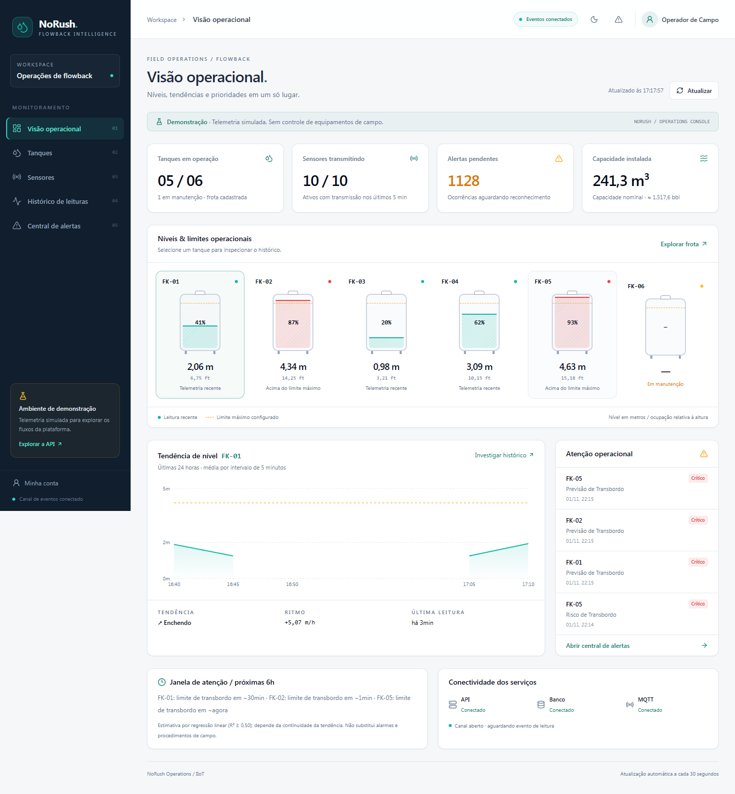

<sub>Operations overview with simulated gauges. More screens [below](#screens).</sub>

## Why

Manual gauging means standing at an open hatch over hydrocarbon vapor. In 2016, OSHA and NIOSH issued a [hazard alert](https://www.osha.gov/Publications/OSHA3843.pdf) after worker deaths during manual tank gauging and sampling. Its first recommendation is to gauge and sample remotely, without opening the hatch. NoRush is the software side of that workflow:

- **What it measures:** one gauge per tank reports the total level (product float) and the oil/water interface (interface float).
- **What it does with the readings:**
  - turns them into barrels of oil and water;
  - keeps the history;
  - estimates when each tank reaches its high level or overflow point;
  - tracks every alarm from acknowledgment to resolution.

**Out of scope:** shutdowns, separator automation, high-level interlocks and gas detection. They need equipment at every tank connection and at the separator itself, and are left to dedicated systems.

## What you can demo

- **Operations view:**
  - level in ft or m;
  - fill relative to tank height;
  - nominal capacity in bbl or m³;
  - age of the latest reading.
- **Oil/water interface:** water and oil layer thickness from the same gauge, plotted over time.
- **Fleet:**
  - tank map and level limits;
  - detail drawer with history;
  - fill-rate trend and time-to-high-level / time-to-overflow estimates.
- **Setup from the console:**
  - tanks: dimensions, alarm limits and the strapping table pasted from the gauge chart (feet-inches and bbl accepted);
  - gauges: register one per tank and get its device credential, shown once; issue a new one or revoke it later.
- **Instrumentation:** status, last transmission, battery and signal for each gauge.
- **History:** 5-minute and 1-hour aggregates for level and interface.
- **Gauge report:** the morning gauge sheet, filled in by the gauges.
  - daily (7:00 to 7:00 by default) or 12-hour day and night shifts;
  - opening and closing gauge per tank in ft-in, oil and water in bbl;
  - hauls and transfers detected as removals, production = closing − opening + removed;
  - CSV download and a print layout.
- **Alarms:**
  - search, filters and pagination;
  - acknowledgment and resolution, both recording who acted and what was done.
- **API:**
  - input validation, JWT auth with roles, rate limiting;
  - OpenAPI docs and health checks;
  - per-device credentials for real hardware.

## Screens

<table>
  <tr>
    <td colspan="2" valign="top">
      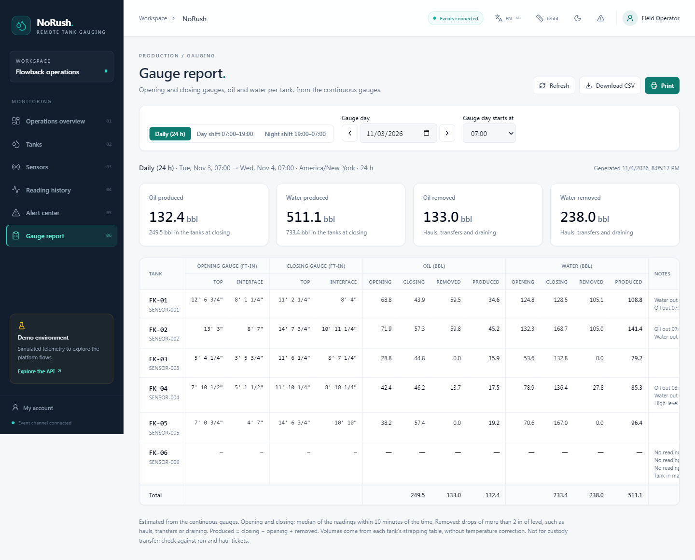
      <br><sub><b>Gauge report.</b> Daily or 12-hour shift: opening and closing gauges, oil and water produced and removed, hauls in the notes. CSV and print.</sub>
    </td>
  </tr>
  <tr>
    <td width="50%" valign="top">
      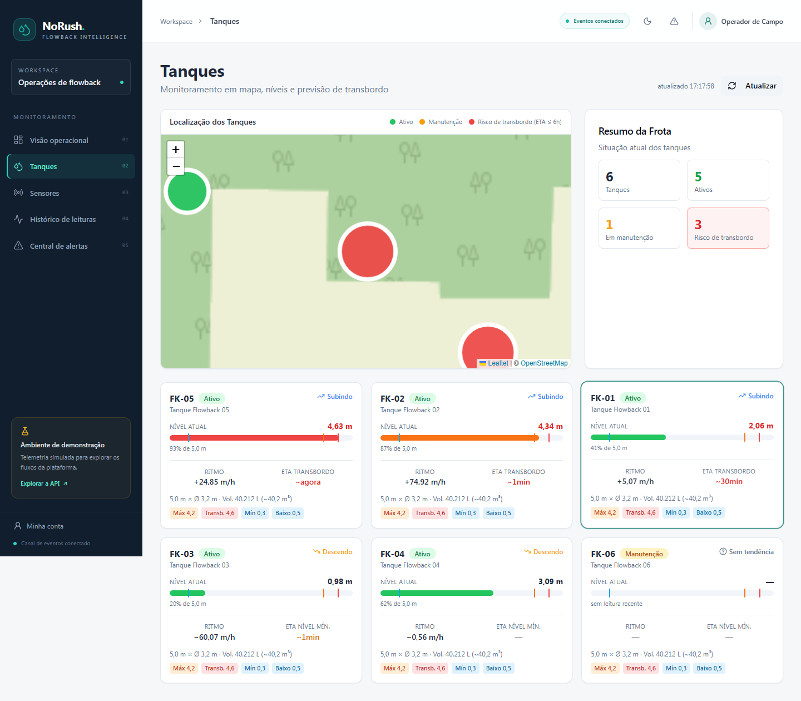
      <br><sub><b>Tanks.</b> Map of the pad, level and time to overflow for each tank.</sub>
    </td>
    <td width="50%" valign="top">
      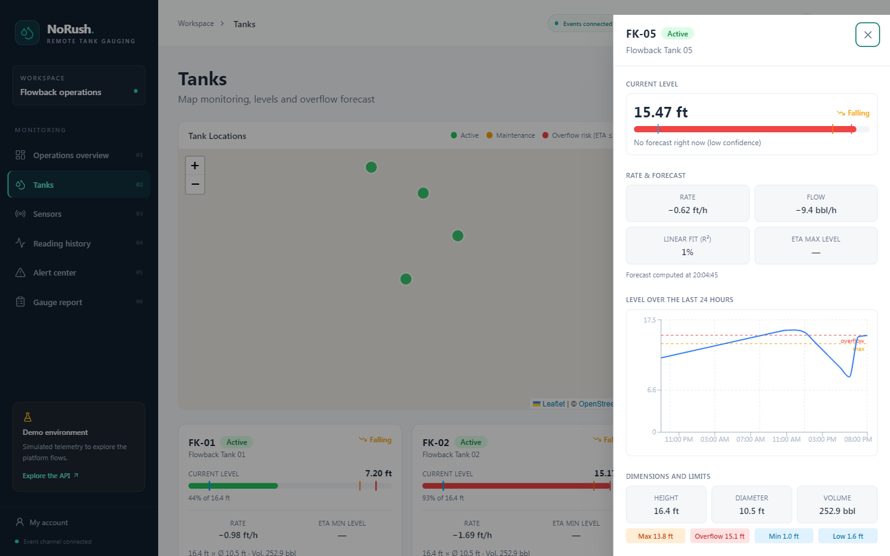
      <br><sub><b>Tank detail.</b> Rate, forecast fit and the last 24 hours.</sub>
    </td>
  </tr>
  <tr>
    <td width="50%" valign="top">
      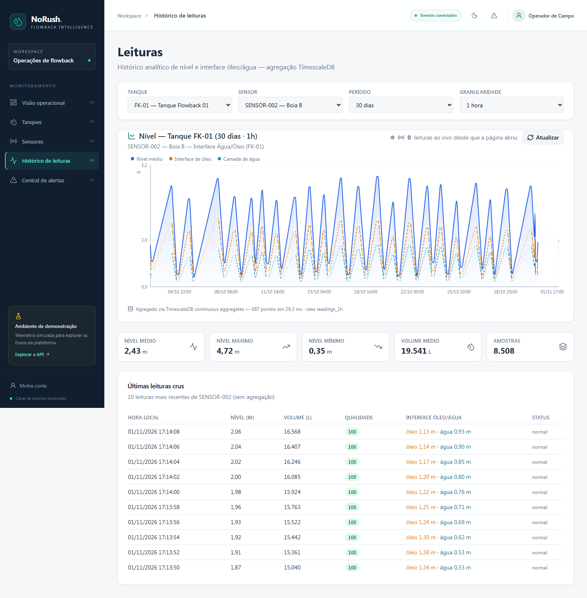
      <br><sub><b>Reading history.</b> Total level and oil/water interface from the same gauge.</sub>
    </td>
    <td width="50%" valign="top">
      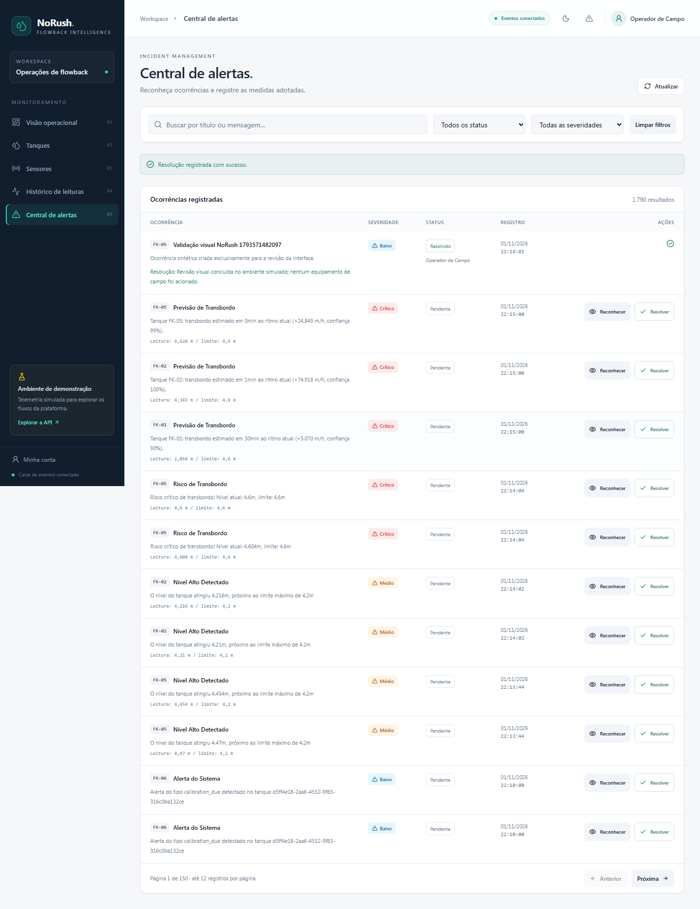
      <br><sub><b>Alert center.</b> Acknowledge, resolve, and record who acted and what was done.</sub>
    </td>
  </tr>
  <tr>
    <td width="50%" valign="top">
      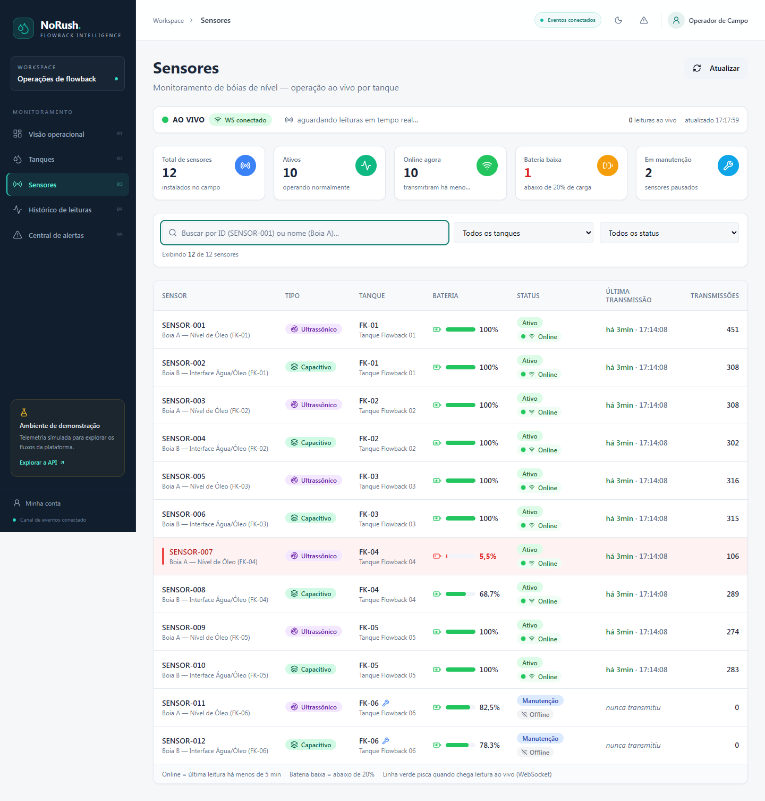
      <br><sub><b>Gauges.</b> Battery, status and last transmission per tank.</sub>
    </td>
    <td width="50%" valign="top">
      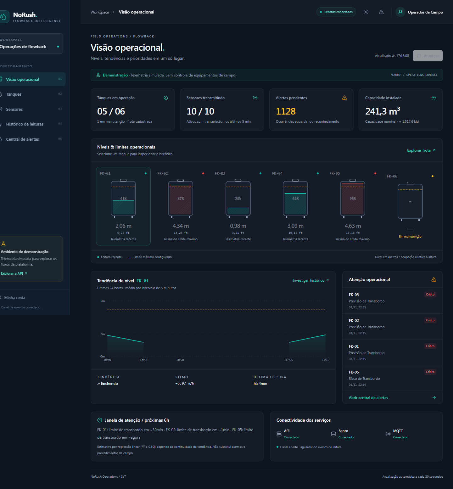
      <br><sub><b>Dark theme</b> for night shifts.</sub>
    </td>
  </tr>
  <tr>
    <td width="50%" valign="top">
      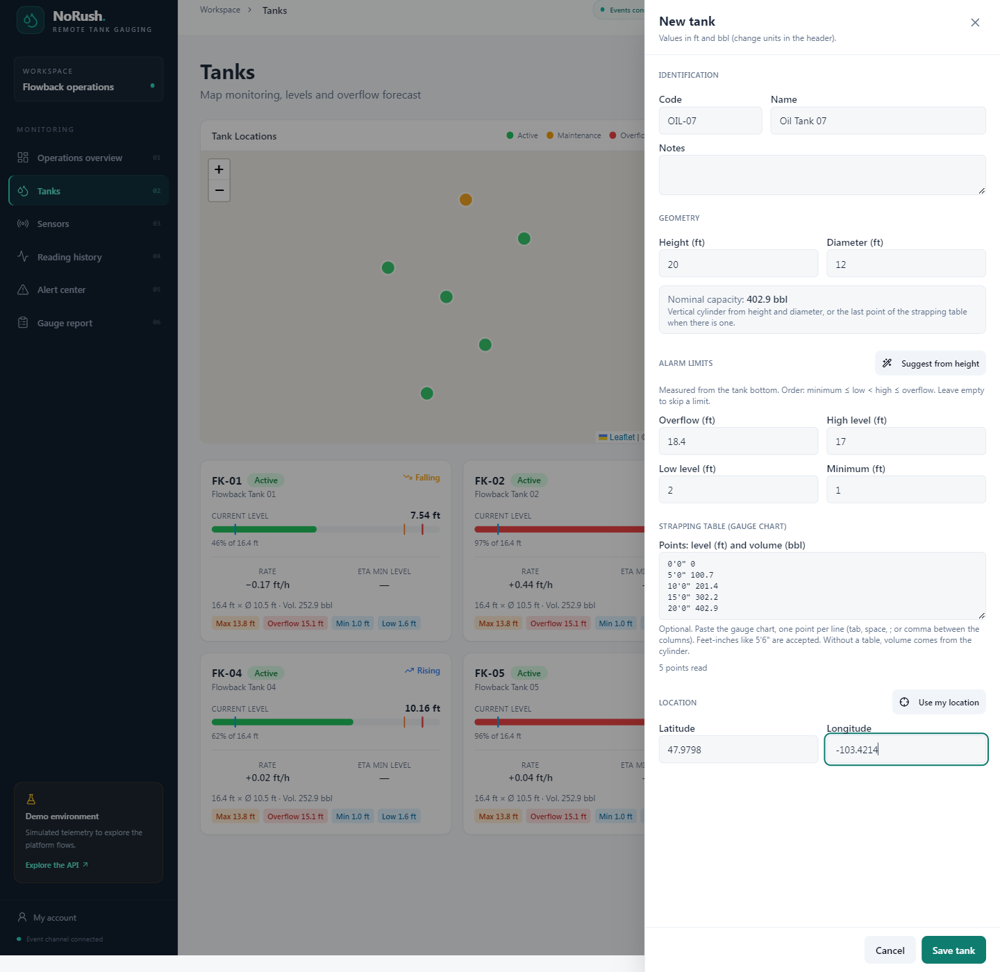
      <br><sub><b>Tank setup.</b> Alarm limits and the strapping table pasted from the gauge chart (ft-in and bbl).</sub>
    </td>
    <td width="50%" valign="top" align="center">
      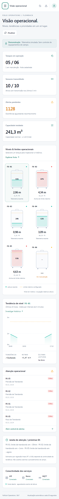
      <br><sub><b>On a phone</b>, from the truck.</sub>
    </td>
  </tr>
</table>

Imperial units are the default; metric, Portuguese and Spanish are one click away in the header. To regenerate these images from a running demo, use `npm run screenshots` (see [scripts/screenshots.mjs](scripts/screenshots.mjs)).

## Run the demo

Requirements: **Node.js 22.20+**, npm and Docker Compose. Run the commands from the repository root (they work in PowerShell).

```powershell
npm ci
npm run setup:demo
npm run infra:up
npm run seed
npm run demo
```

In a second terminal, from the same folder:

```powershell
npm run simulate
```

1. Open **[localhost:3001](http://localhost:3001)**.
2. Click **Fill demo credentials**, then **Sign in to the platform**.

Demo accounts (local environment only):

| Role | Email | Password |
| --- | --- | --- |
| Operator | `operador@flowback.com` | `operador123` |
| Admin (from the seed) | `admin@flowback.com` | `admin123` |

`setup:demo` writes a git-ignored `.env` with separate secrets for access tokens, refresh tokens and ingestion. It keeps an existing file, and the seed keeps a database that already has tanks.

- Console: [http://localhost:3001](http://localhost:3001)
- API / OpenAPI: [http://localhost:3000/api/docs](http://localhost:3000/api/docs)
- API and database health: [http://localhost:3000/health](http://localhost:3000/health)
- Full walkthrough: [DEMO.md](DEMO.md)

## What the simulation models

There are six cylindrical tanks (5 m × 3.2 m), each with **one dual-float gauge**:

- **Physics:** the true level follows `dLevel/dt = flow / area` under a per-tank scenario (filling, fast filling, draining, static, slow fill to overflow, and one tank in maintenance).
- **Sensor:**
  - 5 mm Gaussian noise and 1 mm resolution;
  - battery drain with solar recharge;
  - signal random walk and ~3% packet loss.
- **Interface:**
  - the water fraction drifts from about 60% to 80%, because flowback tanks are mostly water;
  - oil + water thickness always equals the total level.
- **Scripted failure:** SENSOR-004 (FK-04) starts with a critical battery, drains and goes silent.

`SIM_SPEED` speeds up the physics, while timestamps stay on the real clock. Rates and ETAs from an accelerated demo are not field measurements.

## Architecture

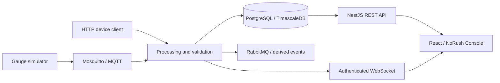

Persistence and the main processing happen in the backend. RabbitMQ receives derived events and is not a required step before persistence. Redis is in the Compose file but is not presented as an exercised cache in the main flow.

| Layer | Implementation |
| --- | --- |
| Backend | NestJS, TypeScript, TypeORM, class-validator, JWT and Socket.IO |
| Data | PostgreSQL/TimescaleDB, hypertable and continuous aggregates |
| Telemetry | MQTT and HTTP. A shared demo ingest key, or per-device credentials with rotation and revocation |
| Frontend | React, TypeScript, Tailwind CSS, Recharts and Leaflet |
| Verification | Jest, HTTP/WebSocket smoke tests and an MQTT simulator |
| Packaging | npm workspaces, a single lockfile and local Docker Compose |

## Rules that keep a reading trustworthy

- **Units:** the platform stores **meters and liters**. The console shows **imperial (ft/bbl, the US oilfield default)** or **metric (m/L)**, chosen in the header, and alert messages are written in the requested unit system (`?units=metric|imperial`).
  - Conversion factors: 1 ft = 0.3048 m and 1 bbl ≈ 158.9873 L ([NIST SP 811](https://www.nist.gov/pml/special-publication-811/nist-guide-si-appendix-b-conversion-factors/nist-guide-si-appendix-b9)).
  - These are unit conversions only: no temperature or pressure correction, and no custody-transfer certification.
- **Interface:** `oilLevel` and `waterLevel` are layer thicknesses that sum to the total level, within 1 mm. `interfaceLevel` is the interface height from the tank bottom and must sit between 0 and the total level. A water-majority tank is valid.
- **Freshness:** an active gauge counts as transmitting if it reported in the last **5 minutes**.
- **Forecasts:**
  - they need a reading from the last **15 minutes** and at least **5 valid samples**; older data suspends current values and ETAs;
  - they use the tank's continuous level gauge, with the dual-float gauge first; point float switches are excluded.
- **ETAs:** linear regression with fit **R² ≥ 0.50** and a 72-hour horizon. R² describes the model fit, not a safety probability.
- **Ingestion:** invalid data is rejected **before** it is stored, queued or broadcast.
- **Health:** database and MQTT status are actually checked. Unmeasured connections never show a fake "healthy" indicator.

Aggregates include the recent tail with `materialized_only=false`, and startup leaves the current interval out of materialization. This follows the [TimescaleDB documentation](https://www.tigerdata.com/docs/learn/continuous-aggregates/real-time-aggregates).

## Verification

```powershell
npm run check             # backend/frontend builds and unit tests
npm run smoke             # real local API and database; creates a synthetic reading and alert
npm run smoke:telemetry   # MQTT → processing → database → authenticated WebSocket
```

The smoke test keeps one resolved synthetic alert tagged `source: norush-smoke` so the record can be inspected. See the [validation log](docs/VALIDATION.md).

## Connect real gauges

[`norush-edge`](edge/README.md) runs on a small PC at the pad:
- it reads each gauge from the vendor's Modbus gateway (Modbus TCP, RS-485 RTU, or RTU over TCP);
- it sends level and oil/water interface to the server over HTTPS, with each gauge's device credential;
- it keeps readings on disk while the internet is down.

The built-in register map follows the SignalFire Sentinel Float Stick interface manual. It has not yet been run against a live gateway. Other gauges with a Modbus gateway can be added with a profile file. NoRush is not affiliated with any gauge manufacturer; product names only say which register map a profile follows.

To install the server for real (migrations, first admin, HTTPS, no demo data), see [Production install](docs/production-install.md).

## Documentation

- [User guide](docs/user-guide.md): every console screen, roles, alerts and forecasts, for operators and admins.
- [Gauge adapter (norush-edge)](edge/README.md): install, commissioning, troubleshooting, register profiles.
- [Production install](docs/production-install.md)
- [Backend](backend/README.md)
- [All documentation](docs/README.md), including the hardware integration contract, the validation log, planning notes and the archived hardware R&D (Portuguese).

**Future research, on standby:** a NoRush-designed battery head and float hardware, with Ada/SPARK + C firmware prototyped only on the host simulator. See [firmware/](firmware/).

## Contributing

Field reports matter as much as code, especially a run of `norush-edge` against a live gateway. See [CONTRIBUTING.md](CONTRIBUTING.md). To report a security problem, see [SECURITY.md](SECURITY.md).

## Limits of this release

**Ingestion credentials:** two models are supported.
- The shared demo key (`IOT_AUTH_MODE=shared`).
- Per-device credentials provisioned through the admin API (`device`/`hybrid`), with rotation, revocation and MQTT topic binding.

**Still needs dedicated work:**
- per-device certificates (mTLS) and broker topic ACLs;
- industrial provisioning and end-to-end TLS terminated in firmware;
- session revocation and rotation;
- long-term observability and field failure testing;
- a run of `norush-edge` against a live gauge gateway: so far it has been tested against the manual's register layout only;
- alerts outside the console: the API's e-mail, SMS, push and Slack channels are placeholders that build the message but do not send it, and they are off by default.

**What this project does not claim:**
- Forecasts do not replace alarms, interlocks or operating procedures.
- No ATEX, IECEx, UL/CSA or SIL certification.
- No field validation and no measured incident reduction.
- No delivered mobile app.

**Reports:** the inherited report catalog has more types than PDF templates. The alert summary is the available template, and the validation log lists the formats actually exercised.

**Development defaults** are for the local demo only: database password `secure_password`, sample JWT secrets, an MQTT broker with `allow_anonymous true`, and pgAdmin/Portainer in Compose. With `NODE_ENV=production` the API refuses short, default or repeated JWT secrets. The database password, broker authentication and ACLs must be set by whoever deploys it.

License: MIT (see [LICENSE](LICENSE)).
