# NoRush · Medição Remota de Tanques

[](https://github.com/lucien-vallois/NoRush/actions/workflows/quality.yml)
[](https://github.com/lucien-vallois/NoRush/releases)
[](LICENSE)


**Medição remota de nível de óleo e da interface óleo/água em tanques de flowback e produção.** O operador acompanha os tanques do pad pelo console, sem subir no tanque, abrir a escotilha (thief hatch) ou descer o stick com pasta reveladora de água.

[English](README.md)

> **Estágio:** protótipo de software exercitado localmente com dados simulados. Não foi qualificado para controlar equipamentos, atuar como sistema de segurança ou operar em campo. O NoRush não tem hardware próprio. O modelo de dados segue as hastes magnetostritivas de duas boias já vendidas para esse uso, com cabeça sem fio a bateria certificada para Class I, Division 1.

## Por quê

Medir na mão é ficar na escotilha aberta sobre vapor de hidrocarboneto. Em 2016, OSHA e NIOSH publicaram um [alerta](https://www.osha.gov/Publications/OSHA3843.pdf) depois de mortes de trabalhadores durante medição e amostragem manual de tanques. A primeira recomendação é medir e amostrar remotamente, sem abrir a escotilha.

Cada tanque tem uma haste que envia o nível total e a interface óleo/água. O NoRush converte isso em barris de óleo e de água, guarda o histórico, estima quando o tanque chega ao nível alto ou ao transbordo e registra cada alarme do reconhecimento à resolução.

**Fora do escopo:** desligamentos, automação de separador, intertravamentos de nível alto e detecção de gás.

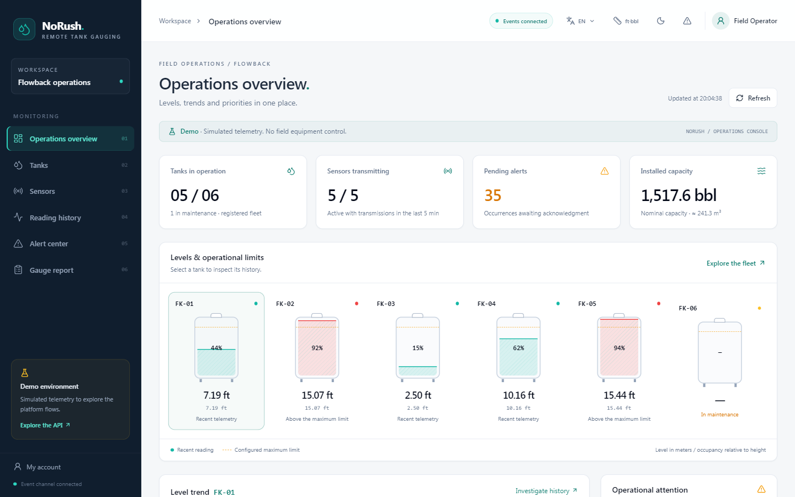

<sub>Visão operacional com hastes simuladas. As capturas mostram o console em inglês; português e espanhol estão a um clique no cabeçalho. Mais telas [abaixo](#telas).</sub>

## O que você pode demonstrar

- **Visão operacional:** nível em ft ou m, ocupação relativa à altura, capacidade nominal em bbl ou m³ e idade da leitura.
- **Frota:** localização dos tanques, limites de nível e painel de detalhe com histórico.
- **Cadastro pelo console:**
  - tanques: dimensões, limites de alarme e tabela de arqueação colada do gauge chart (aceita pés e polegadas e bbl);
  - hastes: cadastro de uma por tanque com emissão da credencial do dispositivo, exibida uma única vez; depois dá para emitir uma nova ou revogar.
- **Instrumentação:** status, transmissão, bateria e sinal de cada haste (uma por tanque, com boia de produto e boia de interface).
- **Histórico:** séries de nível e interface óleo/água, com agregações de 5 minutos e 1 hora.
- **Relatório de medição:** a planilha da medição da manhã, preenchida pelas hastes.
  - diário (7:00 às 7:00 por padrão) ou turnos de 12 horas, dia e noite;
  - medição de abertura e fechamento por tanque em pés e polegadas, óleo e água em bbl;
  - carretas e transferências detectadas como retiradas; produção = fechamento − abertura + retirado;
  - download em CSV e layout de impressão.
- **Ocorrências:** busca, filtros, paginação, reconhecimento e resolução com identificação do usuário e registro da medida adotada.
- **API:** validação de entrada, autenticação JWT, papéis de acesso, limitação de requisições, documentação OpenAPI e verificação de conectividade.

## Telas

<table>
  <tr>
    <td colspan="2" valign="top">
      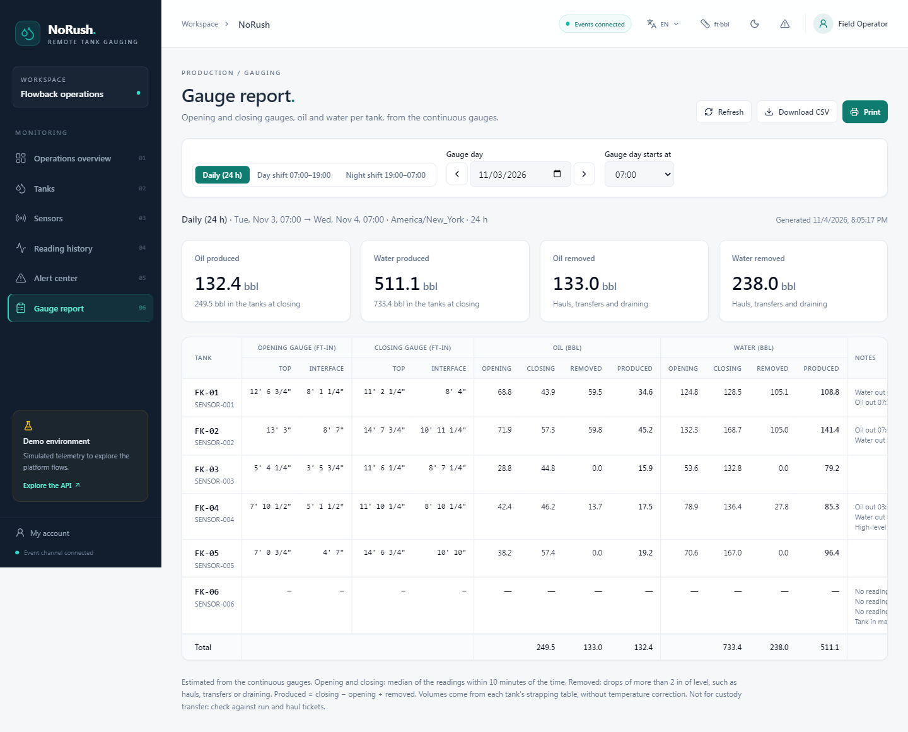
      <br><sub><b>Relatório de medição.</b> Diário ou turno de 12 horas: abertura e fechamento, óleo e água produzidos e retirados, carretas nas observações. CSV e impressão.</sub>
    </td>
  </tr>
  <tr>
    <td width="50%" valign="top">
      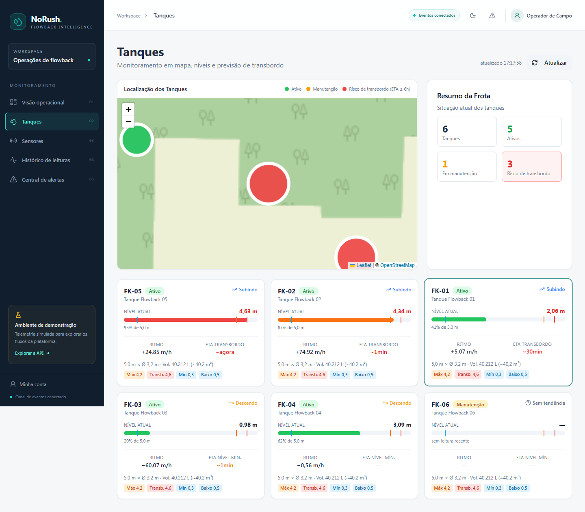
      <br><sub><b>Tanques.</b> Mapa do pad, nível e tempo até o transbordo de cada tanque.</sub>
    </td>
    <td width="50%" valign="top">
      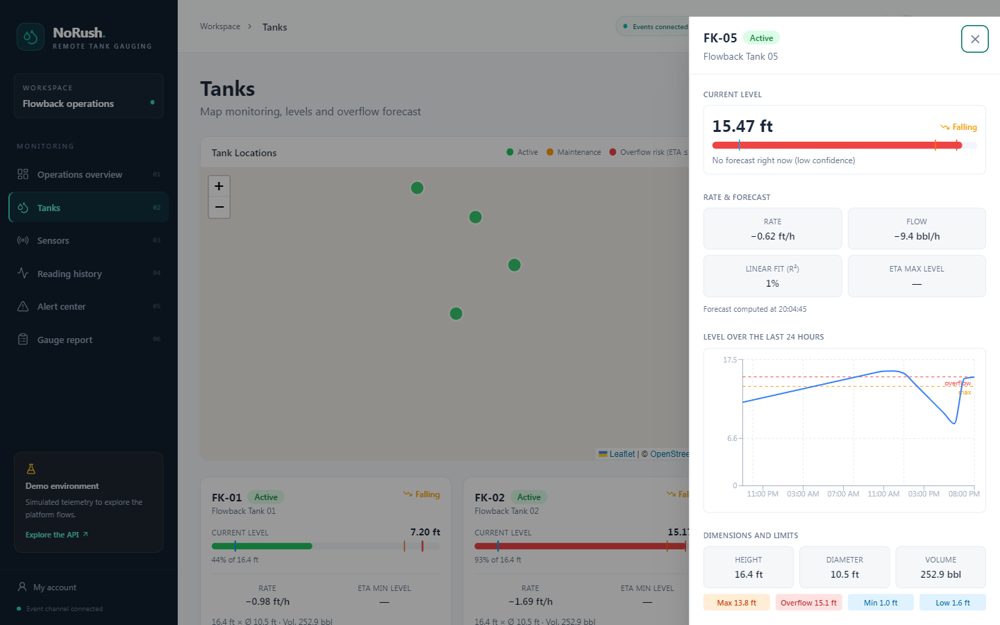
      <br><sub><b>Detalhe do tanque.</b> Ritmo, ajuste da previsão e as últimas 24 horas.</sub>
    </td>
  </tr>
  <tr>
    <td width="50%" valign="top">
      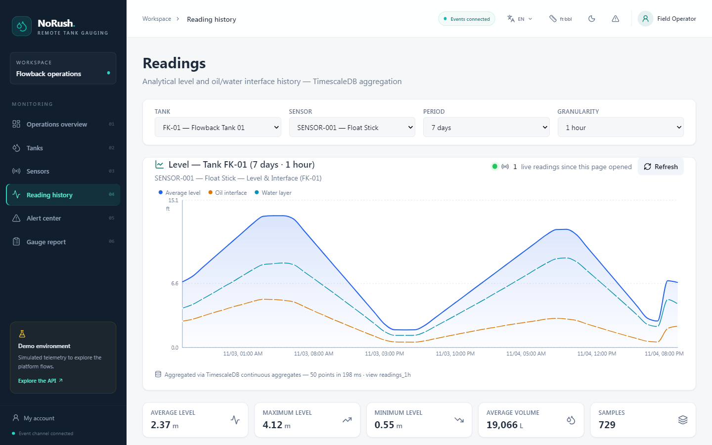
      <br><sub><b>Histórico.</b> Nível total e interface óleo/água da mesma haste.</sub>
    </td>
    <td width="50%" valign="top">
      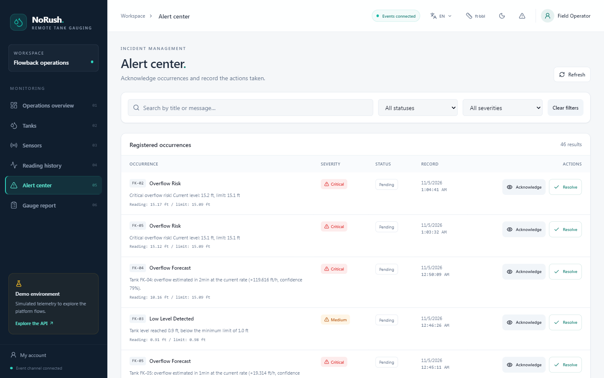
      <br><sub><b>Central de alertas.</b> Reconhecer, resolver e registrar quem agiu e o que foi feito.</sub>
    </td>
  </tr>
  <tr>
    <td width="50%" valign="top">
      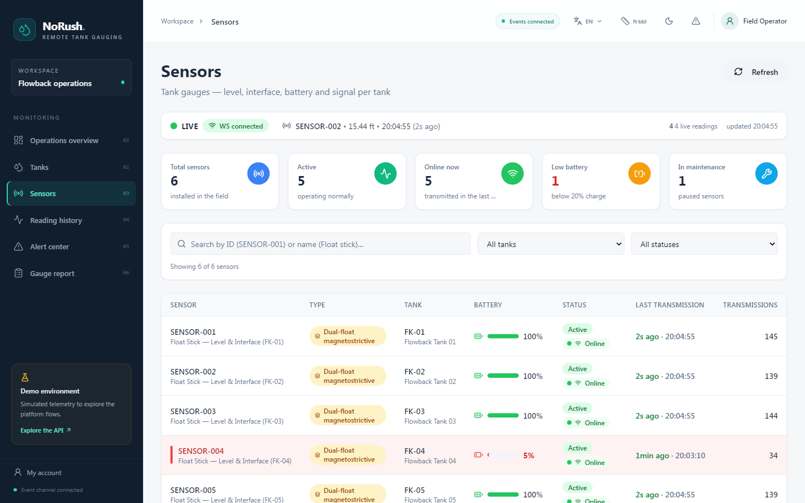
      <br><sub><b>Hastes.</b> Bateria, status e última transmissão por tanque.</sub>
    </td>
    <td width="50%" valign="top">
      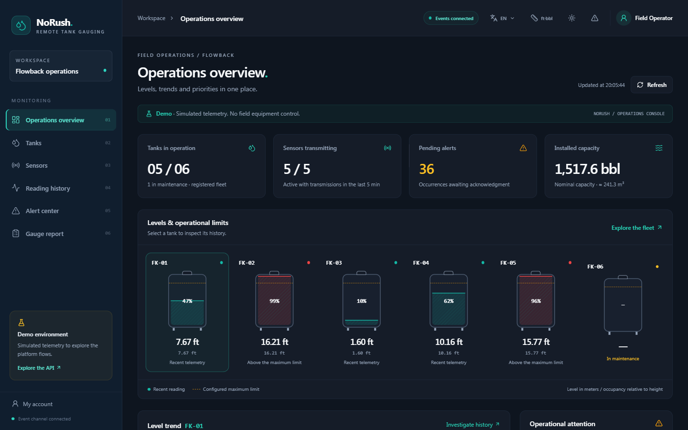
      <br><sub><b>Tema escuro</b> para o turno da noite.</sub>
    </td>
  </tr>
  <tr>
    <td width="50%" valign="top">
      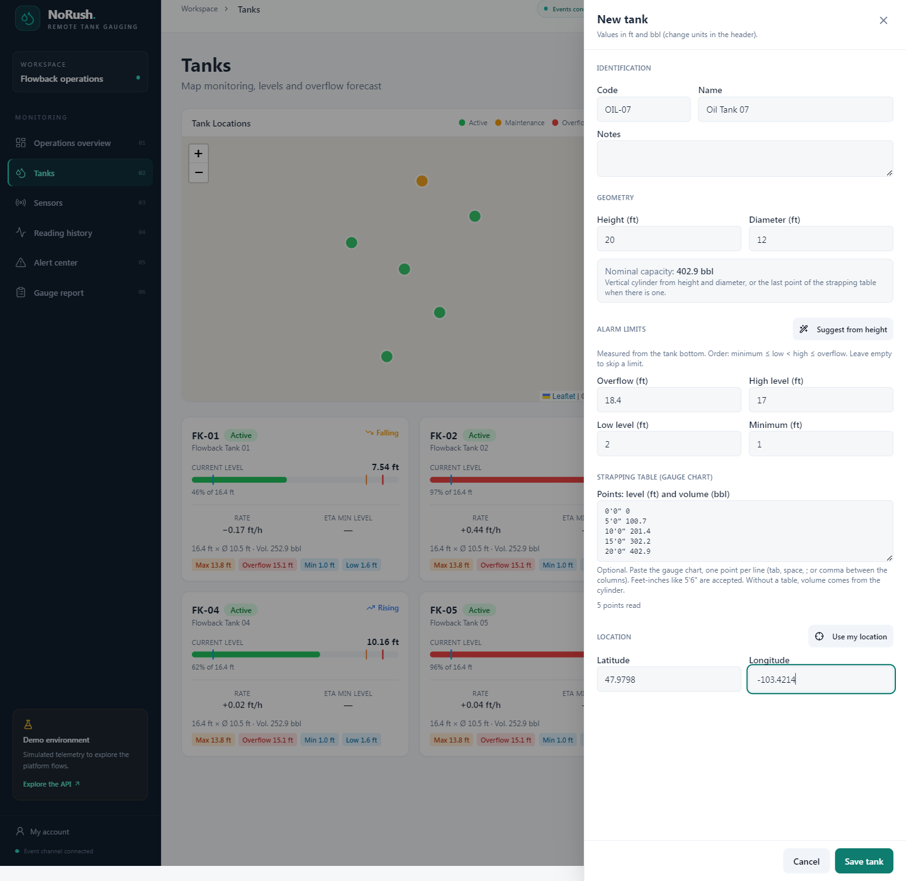
      <br><sub><b>Cadastro de tanque.</b> Limites de alarme e tabela de arqueação colada do gauge chart (ft-in e bbl).</sub>
    </td>
    <td width="50%" valign="top" align="center">
      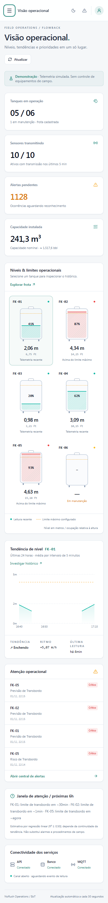
      <br><sub><b>No celular</b>, de dentro da caminhonete.</sub>
    </td>
  </tr>
</table>

Para gerar estas imagens de novo a partir de uma demonstração rodando: `npm run screenshots` (ver [scripts/screenshots.mjs](scripts/screenshots.mjs)).

## Rodar a demonstração

Requisitos: **Node.js 22.20+**, npm e Docker Compose. Os comandos partem da raiz deste repositório e funcionam no PowerShell.

```powershell
npm ci
npm run setup:demo
npm run infra:up
npm run seed
npm run demo
```

Em outro terminal, na mesma pasta:

```powershell
npm run simulate
```

Abra **[localhost:3001](http://localhost:3001)**. Clique em **Fill demo credentials** e depois em **Sign in to the platform** (com o console em português: **Preencher acesso de demonstração** e **Entrar na plataforma**). O acesso demonstrativo é `operador@flowback.com` / `operador123`; a conta administrativa do seed é `admin@flowback.com` / `admin123`. Essas contas são exclusivas do ambiente local.

O comando `setup:demo` gera um arquivo `.env` ignorado pelo Git, com segredos distintos para acesso, refresh e ingestão. Ele preserva um arquivo existente. O seed também preserva uma base que já contém tanques. Não utilize as contas de exemplo fora da demonstração.

- Console: [http://localhost:3001](http://localhost:3001)
- API/OpenAPI: [http://localhost:3000/api/docs](http://localhost:3000/api/docs)
- Saúde da API e do banco: [http://localhost:3000/health](http://localhost:3000/health)
- Roteiro completo: [DEMO.pt-BR.md](DEMO.pt-BR.md)

## Arquitetura implementada

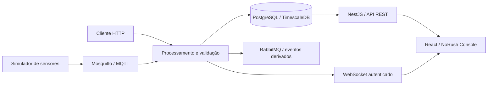

A gravação e o processamento principal ocorrem no backend. RabbitMQ recebe eventos derivados; não é uma etapa obrigatória anterior à persistência. Redis está disponível no Compose, mas não é apresentado como cache exercitado do fluxo principal.

| Camada | Implementação |
| --- | --- |
| Backend | NestJS, TypeScript, TypeORM, class-validator, JWT e Socket.IO |
| Dados | PostgreSQL/TimescaleDB, hypertable e agregados contínuos |
| Telemetria | MQTT e HTTP; chave de ingestão compartilhada (demo) ou credencial por haste, com rotação e revogação |
| Frontend | React, TypeScript, Tailwind CSS, Recharts e Leaflet |
| Verificação | Jest, smoke HTTP/WebSocket e simulador MQTT |
| Empacotamento | npm workspaces, lockfile único e Docker Compose local |
| Firmware (R&D em standby) | Protótipo Ada 2022/SPARK + C, preservado em [firmware/](firmware/) |

A stack real do backend é NestJS/TypeScript. O firmware Ada/SPARK + C pertence à pesquisa de hardware próprio (antigas boias A/B), hoje **em standby**. A presença desse código e dessas especificações não comprova validação física.

## Regras que tornam a leitura útil

- A plataforma calcula e armazena em **metros e litros**; o console exibe no sistema escolhido no cabeçalho — **imperial (ft/bbl, padrão do oilfield americano)** ou **métrico (m/L)** — e as mensagens de alerta são compostas na unidade da requisição (`?units=metric|imperial`). As referências são 1 ft = 0,3048 m e 1 bbl ≈ 158,9873 L, conforme [NIST SP 811](https://www.nist.gov/pml/special-publication-811/nist-guide-si-appendix-b-conversion-factors/nist-guide-si-appendix-b9). O bbl corresponde a 42 galões dos EUA, segundo a [EIA](https://www.eia.gov/tools/glossary/index.php?id=B). São conversões de unidade, sem correção de temperatura/pressão ou certificação de medição comercial.
- Um sensor ativo conta como transmitindo quando teve transmissão nos últimos **5 minutos**.
- A previsão exige leitura recente, de até **15 minutos**, e pelo menos **5 amostras válidas**. Dados antigos suspendem os valores atuais e as ETAs.
- O ETA usa regressão linear com ajuste **R² ≥ 0,50**, dentro de uma janela máxima de 72 horas. R² descreve o ajuste do modelo, não uma probabilidade de segurança.
- Interface: `oilLevel` e `waterLevel` são espessuras das camadas e somam o nível total (tolerância 1 mm); `interfaceLevel` é a altura da interface medida do fundo, entre 0 e o nível total. Tanque com mais água que óleo é válido.
- A previsão usa o sensor de nível contínuo do tanque, com a haste de duas boias em primeiro; chaves de boia pontuais ficam de fora.
- A ingestão rejeita dados inválidos **antes** de gravar, publicar em fila ou transmitir eventos.
- O status do banco e do MQTT é consultado; conexões não medidas não recebem um indicador fictício de sucesso.

Os agregados incluem a cauda recente com `materialized_only=false`; a inicialização deixa o intervalo atual fora da materialização. Isso segue o comportamento descrito na [documentação do TimescaleDB](https://www.tigerdata.com/docs/learn/continuous-aggregates/real-time-aggregates).

## Verificação

```powershell
npm run check             # lint, builds de backend/frontend e testes unitários
npm run smoke             # API e banco reais locais; cria leitura e alerta sintéticos
npm run smoke:telemetry   # MQTT → processamento → banco → WebSocket autenticado
```

O smoke mantém um alerta sintético resolvido, identificado por `source: norush-smoke`, para permitir inspeção do registro. A documentação distingue os resultados locais do workflow preparado para GitHub Actions. Consulte [o registro de validação](docs/VALIDATION.md).

## Conectar hastes reais

O [`norush-edge`](edge/README.md) roda num PC pequeno no pad:
- lê cada haste no gateway Modbus do fabricante (Modbus TCP, RTU por RS-485 ou RTU sobre TCP);
- envia nível e interface ao servidor por HTTPS, com a credencial de cada haste;
- guarda as leituras em disco quando a internet cai.

O mapa de registradores embutido segue o manual de interface do SignalFire Sentinel Float Stick. Ainda não rodou contra um gateway de verdade. O NoRush não tem vínculo com nenhum fabricante de hastes; nomes de produtos só indicam qual mapa de registradores um perfil segue.

Para instalar o servidor de verdade (migrations, primeiro admin, HTTPS, sem dados de demonstração), veja [Production install](docs/production-install.md) (em inglês).

## Documentação

- [Guia do usuário do console](docs/user-guide.md) — em inglês
- [Roteiro de demonstração](DEMO.pt-BR.md)
- [Plano de desenvolvimento (deploy, bancada de interface, integração com haste comercial, piloto)](docs/plano-d-desenvolvimento.md)
- [Adaptador de hastes (norush-edge)](edge/README.md) — em inglês
- [Instalação em produção](docs/production-install.md) — em inglês
- [Contrato de integração de hardware](docs/integracao-hardware.md) ([inglês](docs/hardware-integration.md))
- [Backend](backend/README.md)
- [Pesquisa de hardware próprio — em standby](docs/indice-documentacao.md)
- [Firmware — em standby](firmware/README.md)
- [Demo hospedada no Railway](docs/deploy-railway.pt-BR.md): API, console, worker do simulador e modo somente leitura para demo pública
- [Índice completo da documentação](docs/README.md)
- [Como contribuir](CONTRIBUTING.md) · [Segurança](SECURITY.md)

## Limites desta entrega

A ingestão suporta dois modelos de credencial: a chave compartilhada da
demonstração (`IOT_AUTH_MODE=shared`) e credenciais individuais por
dispositivo provisionadas via API admin (`device`/`hybrid`), com rotação,
revogação e binding de tópico MQTT — o contrato para hardware real está em
[docs/integracao-hardware.md](docs/integracao-hardware.md). Certificados por
dispositivo (mTLS), ACLs por tópico no broker, provisionamento industrial,
TLS ponta a ponta terminado no firmware, rotação de refresh token com
detecção de reuso (o logout já encerra uma sessão, ou todas com `/auth/logout/all`),
observabilidade de longo prazo, testes de falha em campo e o primeiro teste
do `norush-edge` contra um gateway de verdade ainda exigem trabalho específico.

Os canais de notificação da API (e-mail, SMS, push e Slack) são esboços: montam a mensagem mas não enviam, e vêm desligados. Hoje o alerta chega às pessoas só pelo console.

As previsões não substituem alarmes, intertravamentos ou procedimentos de operação. Não há alegação de certificação ATEX, IECEx ou SIL, validação de LoRaWAN em campo, redução de incidentes medida ou aplicação móvel entregue.

Todos os tipos da API de relatórios exportam para Excel; PDF existe só para o resumo de alertas, e o catálogo só o oferece ali. A validação registrada delimita os formatos efetivamente exercitados.

O Compose e os Dockerfiles foram preparados para empacotamento local; sua validação é registrada separadamente do build nativo.

Os valores padrão de desenvolvimento (senha do banco `secure_password`, segredos JWT de exemplo, broker MQTT com `allow_anonymous true`, pgAdmin e Portainer no Compose) existem apenas para a demonstração local. Em produção, `NODE_ENV=production` recusa segredos JWT curtos, padrão ou repetidos; a senha do banco, a autenticação do broker e as ACLs precisam ser configuradas pelo operador.

Licença: MIT (ver [LICENSE](LICENSE)).
