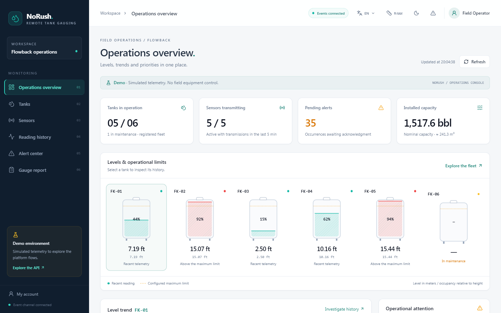
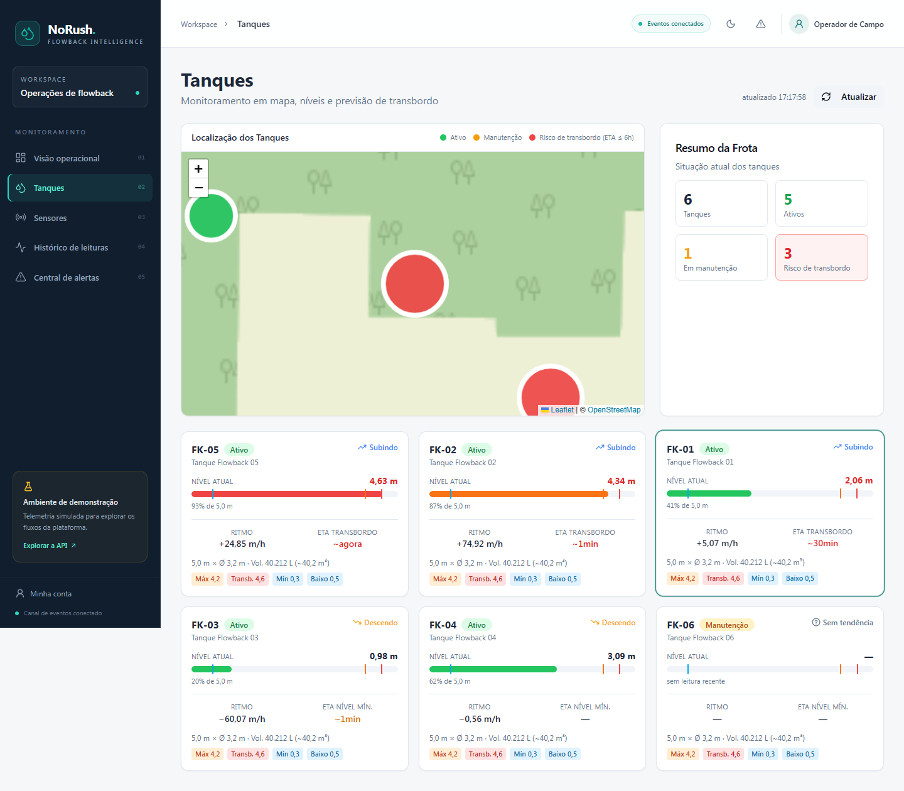
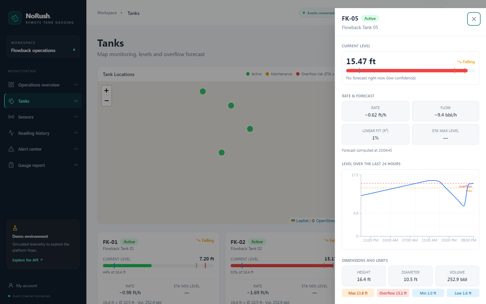
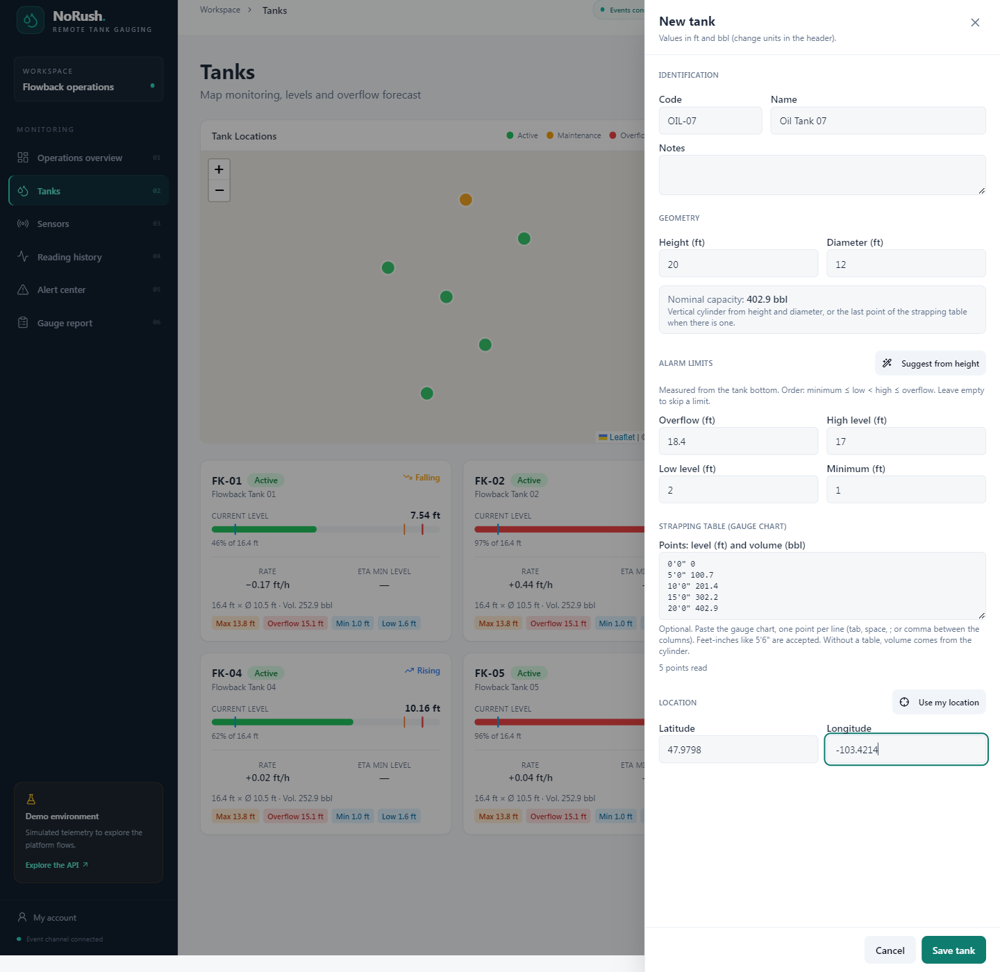
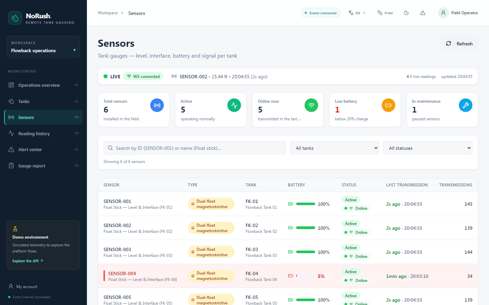
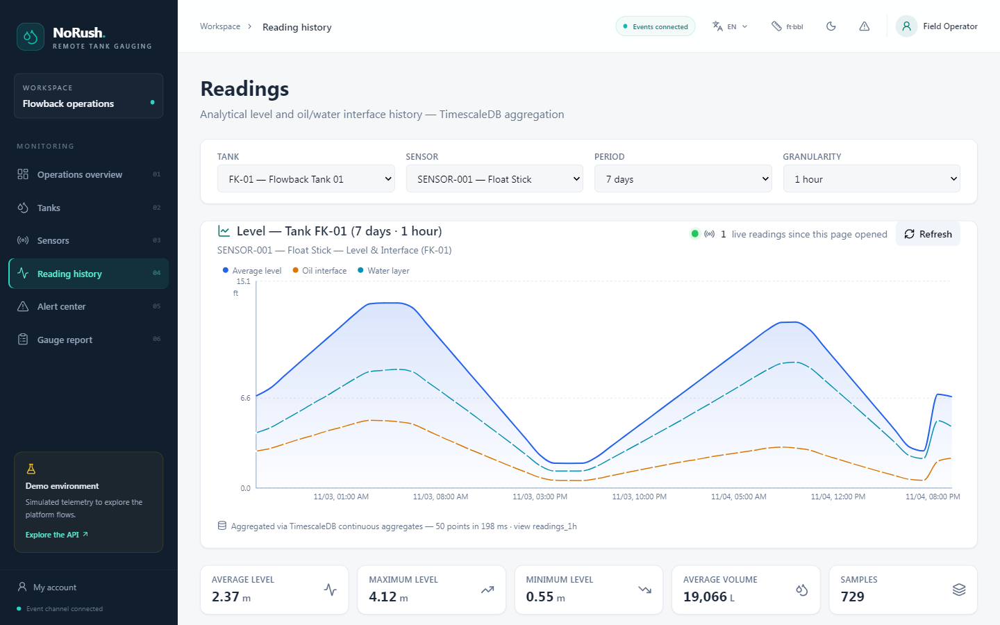
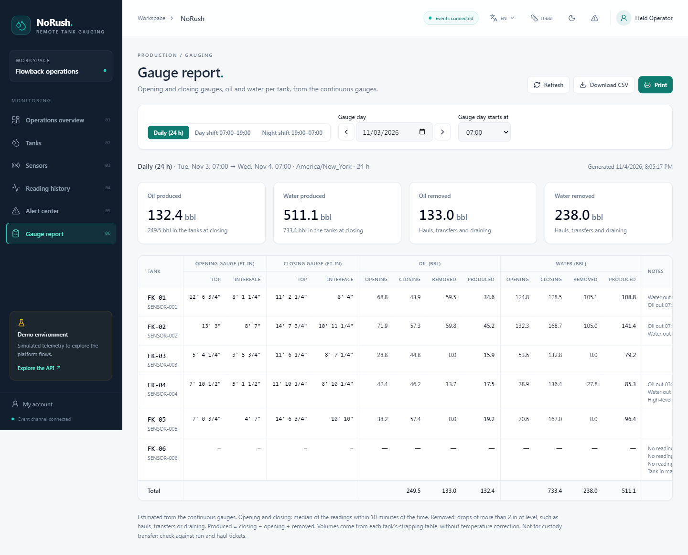
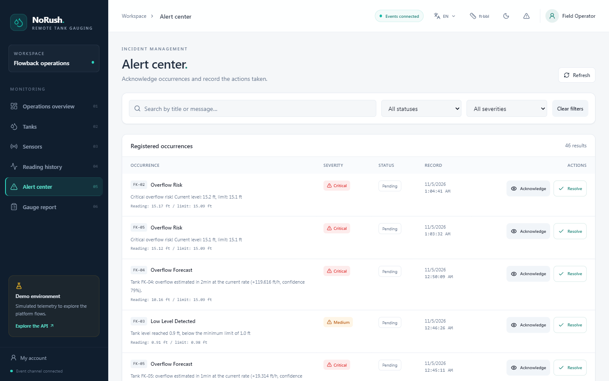

# NoRush console: user guide

This guide is for the people who use the console every day: lease operators and pumpers, flowback hands, supervisors, and whoever sets up the tanks. It covers every screen, what each number means, and what the console does **not** do.

To install the server, see [Production install](production-install.md). To connect gauges at the pad, see the [norush-edge manual](../edge/README.md).

## Before you start

- **NoRush reads; it does not control.** It never opens a valve, shuts in a well or trips a pump. Your high-level alarms, interlocks and procedures stay in charge.
- **Every number comes from a gauge.** One dual-float gauge per tank reports the total level (product float) and the oil/water interface (interface float). When a gauge stops reporting, the console says so instead of showing an old value as current.
- **The demo uses simulated gauges.** A blue *Demo* banner marks it.

## Signing in and roles

Sign in with the e-mail and password your administrator gave you. Each account has one role:

| Role | Can see | Can change |
| --- | --- | --- |
| **Operator** | Everything, including the gauge report | Acknowledge and resolve alerts |
| **Maintenance** | Everything | The above, plus create and edit tanks and edit gauges |
| **Administrator** | Everything | The above, plus register gauges, issue and revoke gauge credentials, create users, delete tanks and gauges |

Buttons you are not allowed to use are hidden. The server checks the role again on every request.

## Header controls

| Control | What it does |
| --- | --- |
| **Units** (ft · bbl / m · L) | Switches the whole console between imperial (the default) and metric. The server stores metric; this only changes the display. |
| **Language** | English, Português, Español. |
| **Theme** | Light or dark. |
| **Bell** | Opens the alert center. |
| **Events connected** | Green when live updates are flowing. If it says *No event connection*, the console still works, but the overview only refreshes every 30 seconds. |

## Operations overview

The first screen. It answers "is anything about to go wrong on this pad?"

**Four cards across the top:**

- **Tanks in operation:** active tanks out of all registered tanks, and how many are in maintenance.
- **Sensors transmitting:** active gauges that reported in the last 5 minutes.
- **Pending alerts:** alerts nobody has acknowledged yet.
- **Installed capacity:** the sum of nominal tank capacities. This is tank size, not oil in the tanks.

**Levels & operational limits:** one drawing per tank.

- The fill and the percentage show the level relative to tank **height**.
- The dashed line is the tank's configured maximum (high level) limit.
- The dot is green for a recent reading, red when the level is above the maximum limit, and amber for a tank in maintenance.
- *No recent reading* means the gauge has not reported recently. The last value is not shown as current.
- Click a tank to load its trend below.

**Level trend:** the last 24 hours for the selected tank, averaged every 5 minutes, with the trend (filling, draining, stable), the rate of change and the age of the last reading.

**Operational attention:** the most recent pending alerts. **Open alert center** takes you to the full list.

**Attention window / next 6h:** tanks projected to reach their overflow limit within 6 hours, with the estimated time. See [Forecasts](#forecasts) for what this estimate is and is not.

**Service connectivity:** whether the console can reach the API, the database and the MQTT broker. *Not checked* means the server did not measure it; it never shows a fake "connected".

## Tanks

A map of tank locations, a fleet summary and one card per tank.

Each card shows the current level, the percentage of height, the rate of change, and the estimated time to overflow (when filling) or to the minimum level (when draining). The limits (Min, Low, Max, Overflow) are listed under the level.

Click a card or a map marker to open the **detail drawer**:

- current level and overflow risk;
- rate, flow, the forecast fit (R²) and the estimated time to the maximum level;
- the level over the last 24 hours;
- dimensions, limits and location.

### Register or edit a tank (maintenance, admin)

Click **New tank**, or **Edit** in the detail drawer. Values are entered in the units chosen in the header.

1. **Identification:** a short **code** (it is what appears everywhere, e.g. `FK-01` or `OIL-3`), a name, notes and the status. *Maintenance* keeps the tank on screen but out of the operating counts.
2. **Geometry:** height and diameter. The nominal capacity is computed as a vertical cylinder, unless you enter a strapping table.
3. **Alarm limits:** measured from the tank bottom, in the order **minimum ≤ low < high ≤ overflow**. Leave a limit empty to skip it. **Suggest from height** fills typical values you can then adjust.
4. **Strapping table (gauge chart):** optional, and better than the cylinder whenever the tank has one. Paste it straight from the chart, one point per line, level then volume, separated by a tab, space, `;` or comma. Feet-inches such as `5'6"` are accepted. The table needs at least 2 points; levels must increase and stay within the tank height, and volumes never decrease. The form tells you which line it could not read.
5. **Location:** **Use my location** on a phone at the tank, or type latitude and longitude.

Click **Save tank**. Errors from the server (limits out of order, a code already in use) appear in the form.

## Sensors (gauges)

The instrument view: one row per gauge with its type, tank, battery, status, last transmission and number of transmissions.

- **Online** means the gauge sent a reading or a heartbeat in the last 5 minutes.
- **Low battery** means below 20%.
- A row flashes green when a live reading arrives.
- Search by Device ID or name, and filter by tank or status (online, offline, low battery).

### Register a gauge (admin)

Every gauge belongs to a tank, so register the tank first.

1. Click **Register gauge**.
2. Pick the **tank**.
3. **Device ID:** the gauge serial or tag (3–64 characters: letters, numbers, `-` and `_`). Leave it empty to generate one.
4. **Measuring range:** the usable rod length. Empty uses the tank height.
5. Model, manufacturer and status are for your records.
6. Click **Register and issue credential**.

The console then shows the gauge's **device credential** (a secret that starts with `nrk_`), its MQTT topic and HTTP endpoint. **Copy the secret now: it is shown only once.** The adapter at the pad (`norush-edge`) needs it to send this gauge's readings.

Later, from **Edit**:

- **Issue new credential:** the old one stops working immediately. Use it if the secret was lost or exposed.
- **Revoke credential:** the server refuses this gauge's telemetry until a new credential is issued.

If the console warns that the server is in `IOT_AUTH_MODE=shared`, per-gauge credentials are ignored. Ask whoever runs the server to switch to `device` (or `hybrid` during a migration).

## Reading history

Pick a **tank**, a **sensor**, a **period** (24 hours, 7 days, 30 days, 90 days) and a **granularity** (5 min or 1 hour).

- The chart shows the level and, for dual-float gauges, the oil/water interface. Hover for max/min, oil and water layers, average volume and number of samples.
- The strip below gives average, maximum and minimum level, average volume and the sample count.
- **Latest raw readings** lists the 10 most recent readings from the gauge, without averaging: local time, level, volume, quality, interface (oil and water thickness) and status.

## Gauge report

The morning gauge sheet, filled in by the gauges: opening and closing gauge for every tank, and the oil and water produced and removed in between. Everyone can open it.

**Choose the period:**

- **Daily (24 h):** one gauge day, from the start hour to the same hour the next day. The default is 7:00 to 7:00; change it under **Gauge day starts at** (the console remembers it).
- **Day shift** and **Night shift:** the first and last 12 hours of the gauge day, for 12-hour tours.
- **Gauge day:** the date the gauge day starts on. The arrows step one day back or forward. The report opens on the last period that has ended.

Times follow your computer's time zone, shown above the table. On the days clocks change, a gauge day is 23 or 25 hours, like the clock on the pad.

**Each row:**

| Column | Meaning |
| --- | --- |
| Opening / Closing gauge, Top | Total liquid level, in feet and inches to the nearest 1/4" (or meters) |
| Opening / Closing gauge, Interface | Oil/water interface height from the bottom |
| Oil and Water, Opening / Closing | Barrels (or m³) of each layer at that gauge, from the strapping table |
| Removed | Barrels that left the tank during the period: hauls, transfers, draining the water leg |
| Produced | What came into the tank: closing − opening + removed |
| Notes | Each removal with its times and volume, high-level alarms, missing readings, long gaps |

The cards on top add up oil and water produced and removed for all tanks.

**How the numbers are worked out**, so you know when to trust them:

- The opening and closing gauges are the median of the readings within 10 minutes of the time. With no reading that close, the nearest reading within 30 minutes is used; otherwise the cell is empty and so is production.
- A **removal** is a drop of more than 2 inches of level in the oil or the water layer. Gauge noise is filtered first, so it is not counted. A slow drain smaller than 2 inches is not counted as removed, and it lowers production instead; a negative production is shown in amber for that reason.
- A gauge without an interface float gives the total liquid only, noted on the row.
- Volumes come from each tank's strapping table, without temperature correction.

**This is an estimate, not a run ticket.** Check removals against your haul and run tickets before you use the numbers for production accounting, and never for custody transfer.

**Download CSV** saves the same report for a spreadsheet, in the units chosen in the header. **Print** gives a landscape page without the menus. The report is also available from the API: `GET /gauge-reports` (JSON) and `GET /gauge-reports/csv`, with `period=daily|day|night`, `date`, `startHour` and `tz`.

## Alert center

Every alert, from the moment it is raised until someone resolves it.

| Alert | Raised when | Severity |
| --- | --- | --- |
| Overflow risk | The level reaches the overflow limit, or the forecast reaches it within 6 hours | Critical (High for a forecast more than 2 h away) |
| Low level, at the minimum limit | The level drops to the minimum (low-low) limit | High |
| High level | The level reaches the high limit | Medium |
| Low level | The level drops to the low limit | Medium |
| Sensor offline | A gauge stops reporting | High |
| Battery low | A gauge reports a low battery | Medium |
| Sensor error / Communication error | The gauge or the link reports a fault | High |

A level past an outer limit also trips the inner one (past overflow, both overflow and high are raised). While an alert is pending or acknowledged, the same condition does not open a new one; once it is resolved, the next crossing does.

Search by title or message, and filter by status (Pending, Acknowledged, Resolved, False positive) and severity (Critical, High, Medium, Low). Twelve alerts per page.

- **Acknowledge:** "I have seen it." It records who acknowledged it and when, with an optional note through the API.
- **Resolve:** opens a box to write what you checked and what you did. The note is tied to your account. Resolving an alert is a record; it does not change anything at the tank.

New alerts also pop up at the bottom of the screen while you are signed in.

## Reading the numbers

- **Level:** height of liquid from the tank bottom.
- **Interface:** height of the oil/water interface from the tank bottom.
- **Oil and water:** layer thicknesses. Oil + water always equals the total level (within 1 mm). A tank that is mostly water is normal on flowback.
- **Volume:** from the strapping table when the tank has one, otherwise from the cylinder. These are unit conversions only: no temperature or pressure correction, and **not for custody transfer**.
- **Units:** 1 ft = 0.3048 m and 1 bbl ≈ 158.987 L.

### Forecasts

The time to overflow or to minimum level is a straight-line fit of the recent level:

- it needs a reading from the last 15 minutes and at least 5 valid samples, otherwise it is suspended;
- it is shown only when the fit is reasonable (R² ≥ 0.50) and within 72 hours;
- it assumes the current rate continues. A truck arriving, a well coming on, or a dump valve opening changes it.

Use it to plan haul trucks and rounds. **It does not replace high-level alarms or a person checking the tank.**

## When something looks wrong

| You see | Likely cause | What to do |
| --- | --- | --- |
| *No recent reading* on a tank | The gauge or the pad adapter stopped sending | Check the Sensors screen for that gauge, then the adapter at the pad (`norush-edge check`) |
| Gauge *Offline* but the tank looks fine | Radio, gateway, adapter or internet at the pad | See [Troubleshooting](../edge/README.md#troubleshooting) in the adapter manual |
| *Forecast suspended* | No reading in the last 15 minutes | Fix the reporting first; the forecast comes back by itself |
| *No event connection* | Live channel down (network, proxy) | The overview keeps refreshing every 30 s; tell whoever runs the server |
| Level differs from a hand gauge | Gauge calibration offset | Calibrate the gauge in the vendor's tool, at the pad, in a safe area |
